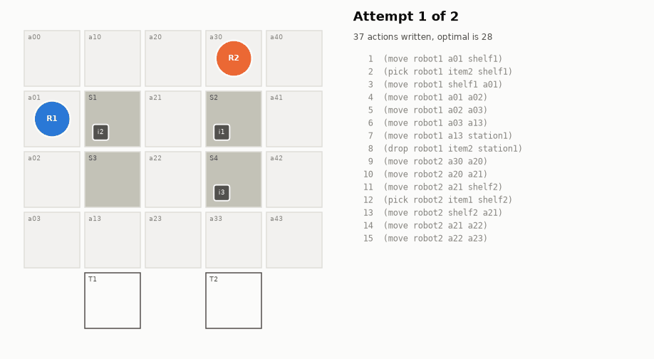
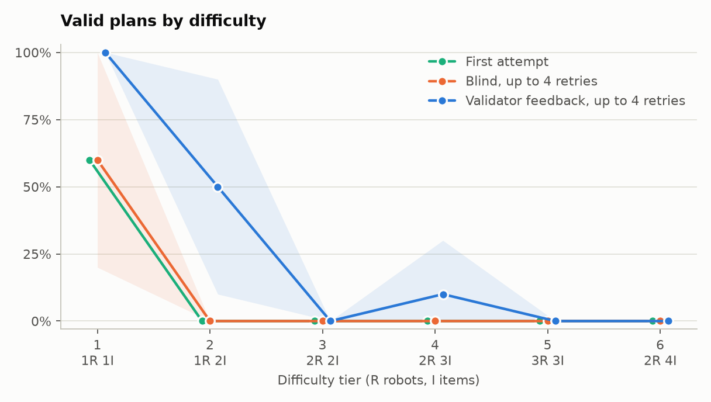

# Verified LLM Planning for Warehouse Robots

A small open LLM writes PDDL plans for warehouse robots. A classical validator checks every step, a rejected plan goes back to the model with the reason, and Fast Downward supplies the optimal plan to compare against. The project measures what that loop is worth, with a control arm that retries without any feedback.



*Qwen3-4B with 2 robots and 3 items. Its first plan runs 36 valid steps and then enters a station from the wrong cell. The validator names the step and the only entrance, and the model finishes in 4 more actions. This is the hardest problem the loop repaired, so it shows the mechanism at its best and is not a typical run.*

## Results

30 problems, up to 4 retries, 95% intervals in brackets.

| Model | Runs | Valid on the first attempt | Valid after feedback | Valid after blind retries | Length / optimal, feedback |
|---|---:|---:|---:|---:|---:|
| Qwen3-4B | 60 | 10.0% [0 to 23] | **26.7%** [12 to 42] | 10.0% [0 to 23] | 1.11 |
| Qwen2.5-1.5B | 30 | 0.0% | 0.0% | 3.3% | n/a |
| Qwen2.5-1.5B + LoRA | 30 | 36.7% [20 to 53] | 43.3% [27 to 60] | **56.7%** [40 to 73] | 1.09 |



Full tables and charts: [Qwen3-4B](results/REPORT_qwen3-4b.md), [Qwen2.5-1.5B](results/REPORT_qwen25-1.5b.md), [with LoRA](results/REPORT_qwen25-lora.md).

**Feedback works on a model that is already close.** On Qwen3-4B, feedback beat blind retries by 16.7 points (95% interval +5.0 to +30.0). Blind retries added nothing to the first attempts. Feedback repaired 10 of the 54 failed first attempts, in 2.0 rounds on average, and delivered 49.6% of all items against 32.8%.

**It does nothing for a model that is not.** Qwen2.5-1.5B produced 0 valid plans in 90 first attempts, and 4 rounds of feedback did not change that. On the dev set, given the same hints, it still invented cells or repeated the rejected move.

**Most of the gain is on the easy tiers.** Feedback took Qwen3-4B from 60% to 100% on tier 1 and from 0% to 50% on tier 2. It solved 1 of 10 runs on tier 4 and none on tiers 3, 5 and 6, where several robots share the map.

**Fine-tuning moved more than feedback did.** Three epochs of LoRA on 120 verified plans took Qwen2.5-1.5B from 0% to 36.7% on the first attempt, ahead of the larger Qwen3-4B.

**The two do not add up.** On the fine-tuned model and known maps, feedback did worse than blind retries, by 13.3 points (95% interval -26.7 to -3.3). The likely reason is that LoRA trained only on plans from the initial state, while a repair starts mid-plan and keeps every locked step, including useless ones. This run does not prove that explanation.

**Fine-tuning carries over to new maps, at a lower level.** Benchmark and training tasks are distinct but share their maps, so every model also ran 20 problems on wider maps that no prompt or training example shows. The table counts valid plans on tiers 1 to 4, the tiers both sets have.

| Model | Known maps, first attempt | New maps, first attempt | Known maps, feedback | New maps, feedback | Known maps, blind | New maps, blind |
|---|---:|---:|---:|---:|---:|---:|
| Qwen2.5-1.5B | 0/20 | 0/20 | 0/20 | 0/20 | 1/20 | 0/20 |
| Qwen2.5-1.5B + LoRA | 11/20 | 4/20 | 13/20 | 7/20 | 16/20 | 6/20 |
| Qwen3-4B | 6/40 | 0/20 | 16/40 | 2/20 | 6/40 | 0/20 |

New maps are harder in their own right: the mean optimal plan grows from 18.4 to 20.7 steps, and Qwen3-4B falls too although it was never trained on any map. So the drop cannot be read as memorization alone. On new maps the fine-tuned 1.5B model still beats Qwen3-4B, and for it feedback and blind retries are level.

**Valid plans are not far from optimal.** Solved runs of Qwen3-4B were 1.11 times the optimal length on average, and half were optimal. Repairs cost the most: the plan in the animation has 40 actions against an optimum of 28, because locked steps cannot be taken back.

## Limits

- 30 problems is a small sample, and the intervals are wide. Qwen3-4B has 2 replicates per problem, the other models have 1.
- Plan length is measured on solved runs only, which are mostly easy problems.
- A plan can be at most 2.5 times the optimal length, because generation stops there.
- Prompts were tuned on the dev set with Qwen2.5-1.5B and then frozen, so Qwen3-4B runs with prompts that were not tuned for it.
- Fine-tuning used Fast Downward's plans, not the model's own. The base model produced too few verified plans to train on, so this measures learning from verified plans and is not a closed self-improvement loop.
- Llama 3.2 1B was not tested because the model is gated, and the Claude backend was not run because no API key was available.
- The Qwen3-4B benchmark was interrupted and resumed while memory problems were fixed. Attempts written under a faulty memory limit were discarded and generated again, and the attempts that remain used batch sizes from 1 to 3.
- Three robots with four items is left out, because Fast Downward could not prove an optimal plan within minutes.

## What the dev set taught

- **The prompt format decides whether the model reads the problem.** With raw PDDL, 11 of 18 attempts failed at step 1. A compact state, goal and adjacency list cut that to 2 of 18.
- **Example order matters.** With the 2-robot example first and the 1-robot example last, 5 of 40 first attempts were valid. In the reverse order, none were.
- **Asking for a corrected plan fails.** The model returned the same plan, and when told about a mid-plan state in prose it went back to the start. A repair therefore restates the task from the state the plan reached, as a new and smaller problem.
- **Nothing after the first wrong step can be used.** Each line is therefore verified during generation, and the sequence stops there.

## How it works

```
                 ┌───────────────────────────────────────────────┐
                 │  state the plan reached + why it was rejected │
                 ▼                                               │
  PDDL problem ──► LLM ──► PDDL plan ──► validator ──► invalid ──┘  at most N rounds
                                             │
                                             ▼
                                           valid ──► length vs. the Fast Downward optimum
```

**Domain.** [pddl/domain.pddl](pddl/domain.pddl) has three actions: `move`, `pick` and `drop`. A location holds one robot and a robot carries one item, so several robots have to avoid each other. Shelves sit between two aisle cells and are entered from the side, and stations are dead ends below the bottom aisle.

**Problems.** 30 benchmark problems in six tiers of five, from 1 robot and 1 item (about 8 steps) to 2 robots and 4 items (about 38 steps). The generator keeps the benchmark, the prompt examples, the dev set, the training set and a set of 20 problems on unseen maps disjoint at the level of tasks, and a test enforces it. Prompts and settings were tuned on the dev set only.

**Validation.** [validator.py](warehouse_planning/validator.py) walks the plan step by step to find the first error and to describe the state at that point. The verdict comes from unified-planning's sequential plan validator, and validation stops with an error if the two ever disagree.

**Feedback loop.** [loop.py](warehouse_planning/loop.py) locks the steps that passed and restates the task from the state they reached:

```
Robots: robot1 is at a22, holding item1.
Items: none left on the shelves.
Goal: item1 to station2.
Map (location: where a robot can move from it): ...

The last attempt from this state was rejected.
Step 7: (move robot1 a22 station2) cannot be executed.
Unsatisfied precondition: (connected a22 station2).
From a22, robot1 can move to: a21, a12, a32.
station2 can only be entered from: a32.

Plan:
```

**Reference.** Fast Downward with A* and LM-cut gives the shortest plan for every problem. Moves have unit cost, so that is the minimum number of actions. [tests/test_planner.py](tests/test_planner.py) checks those lengths against an exhaustive search on tiers 1 to 4.

**Control arm.** Both arms share the same first attempt and the same number of retries. The blind arm resamples the original prompt, so the difference between the arms is the value of the feedback and not of trying more than once. Intervals are 95% bootstraps over problems, because replicates of one problem are not independent.

**Model.** The main model is Qwen3-4B, in 4-bit on a 4 GB GPU. Qwen2.5-1.5B was the first choice but almost never produced a valid plan, so it stays in as the baseline and as the model that gets fine-tuned.

## Reproduce

Requires [uv](https://docs.astral.sh/uv/) and a CUDA GPU. Fast Downward ships as a wheel, so no compiler is needed. On Windows, `msvc-runtime` provides the Visual C++ libraries inside the virtual environment. Everything below ran on an RTX A2000 with 4 GB of memory.

```bash
uv sync
source .venv/Scripts/activate       # .venv\Scripts\activate in PowerShell, .venv/bin/activate on Linux
python -m pytest

python -m warehouse_planning.instances                            # problems, already in pddl/
python -m warehouse_planning.planner examples benchmark dev train unseen   # optimal plans, already in pddl/

python -m warehouse_planning.experiment --label qwen3-4b
python -m warehouse_planning.experiment --label qwen25-1.5b --model Qwen/Qwen2.5-1.5B-Instruct --replicates 1 --batch-size 5

python -m warehouse_planning.finetune --source planner --model Qwen/Qwen2.5-1.5B-Instruct --out adapters/planner
python -m warehouse_planning.experiment --label qwen25-lora --model Qwen/Qwen2.5-1.5B-Instruct --adapter adapters/planner --replicates 1 --batch-size 5

# The same models on maps that no prompt or training example shows
python -m warehouse_planning.experiment --label unseen-qwen3 --split unseen --replicates 1
python -m warehouse_planning.experiment --label unseen-qwen25 --split unseen --model Qwen/Qwen2.5-1.5B-Instruct --replicates 1 --batch-size 5
python -m warehouse_planning.experiment --label unseen-lora --split unseen --model Qwen/Qwen2.5-1.5B-Instruct --adapter adapters/planner --replicates 1 --batch-size 5

python -m warehouse_planning.report --label qwen3-4b --name "Qwen3-4B" \
    --compare qwen25-1.5b="Qwen2.5-1.5B" --compare qwen25-lora="Qwen2.5-1.5B + LoRA"
python -m warehouse_planning.animate --label qwen3-4b
```

Run results are saved after every batch, and an interrupted experiment resumes from its file.

The Claude backend works the same way with `--backend claude`. It needs an API key, and it has unit tests against a fake client but no results here because no key was available.

## Layout

```
pddl/                   domain, problems, reference plans
warehouse_planning/
  instances.py          problem generator and splits
  planner.py            Fast Downward reference plans
  validator.py          plan parsing, verdict, error messages
  prompts.py            planning and repair prompts
  llm.py                Hugging Face and Claude backends
  loop.py               generate, validate, repair, for both arms
  metrics.py            rates, plan quality, bootstrap intervals
  report.py             charts and REPORT files
  animate.py            plan animation
  finetune.py           LoRA fine-tuning on verified plans
tests/                  oracle.py restates the rules without unified-planning or Fast Downward
results/                raw runs, summaries, charts, animation, index.html
```
