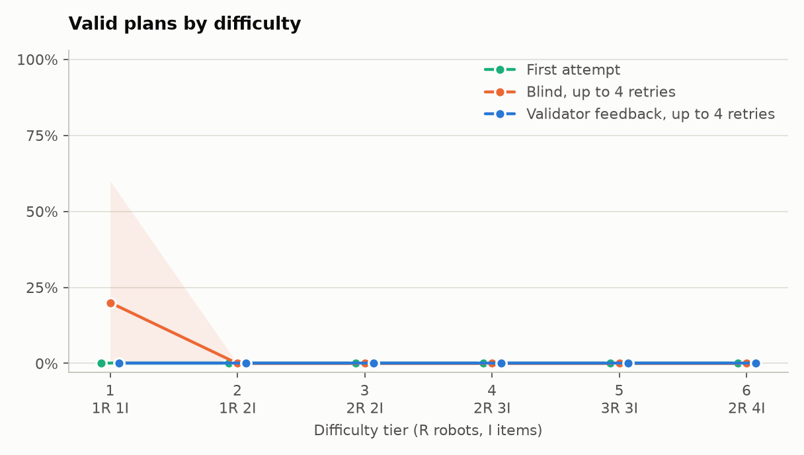
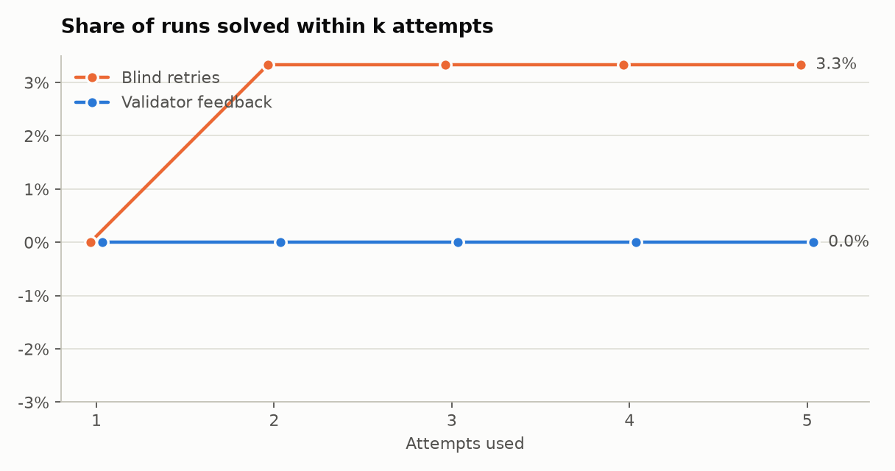
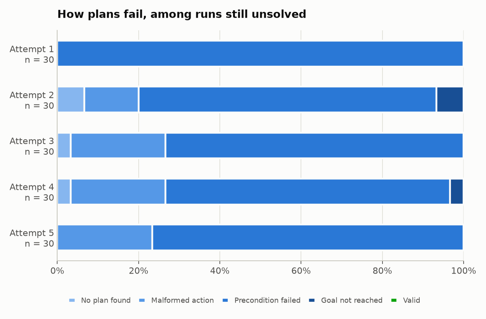

# Results: Qwen/Qwen2.5-1.5B-Instruct

Generated by `python -m warehouse_planning.report`. Do not edit by hand.

30 problems, 1 replicates each, temperature 0.3, up to 4 retries. Intervals are 95% bootstraps over problems.

| Metric | Validator feedback | Blind retries |
|---|---:|---:|
| Runs | 30 | 30 |
| Valid on the first attempt | 0.0% | 0.0% |
| 95% interval | 0.0 to 0.0% | 0.0 to 0.0% |
| **Valid after up to 4 retries** | **0.0%** | **3.3%** |
| 95% interval | 0.0 to 0.0% | 0.0 to 10.0% |
| Items delivered, share of all items | 0.0% | 3.3% |
| Failed first attempts later fixed | 0.0% | 3.3% |
| Mean retries, all solved runs | n/a | 1.00 |
| Mean retries, runs that needed one | n/a | 1.00 |
| Plan length / optimal, mean | n/a | 1.00 |
| Plan length / optimal, median | n/a | 1.00 |
| Valid plans that are optimal | n/a | 100.0% |

Feedback minus blind retries: -3.3 points (95% interval -10.0 to +0.0).

## By difficulty

| Tier | Robots, items | Mean optimal length | First attempt | Blind retries | Validator feedback | Items delivered, blind | Items delivered, feedback |
|---|---|---:|---:|---:|---:|---:|---:|
| 1 | 1, 1 | 8.0 | 0.0% | 20.0% | 0.0% | 20.0% | 0.0% |
| 2 | 1, 2 | 18.2 | 0.0% | 0.0% | 0.0% | 0.0% | 0.0% |
| 3 | 2, 2 | 18.2 | 0.0% | 0.0% | 0.0% | 0.0% | 0.0% |
| 4 | 2, 3 | 29.0 | 0.0% | 0.0% | 0.0% | 0.0% | 0.0% |
| 5 | 3, 3 | 29.2 | 0.0% | 0.0% | 0.0% | 0.0% | 0.0% |
| 6 | 2, 4 | 38.2 | 0.0% | 0.0% | 0.0% | 0.0% | 0.0% |

## By attempt

| Attempt | Runs | No plan found | Malformed action | Precondition failed | Goal not reached | Valid |
|---|---:|---:|---:|---:|---:|---:|
| 1 | 30 | 0.0% | 0.0% | 100.0% | 0.0% | 0.0% |
| 2 | 30 | 6.7% | 13.3% | 73.3% | 6.7% | 0.0% |
| 3 | 30 | 3.3% | 23.3% | 73.3% | 0.0% | 0.0% |
| 4 | 30 | 3.3% | 23.3% | 70.0% | 3.3% | 0.0% |
| 5 | 30 | 0.0% | 23.3% | 76.7% | 0.0% | 0.0% |
