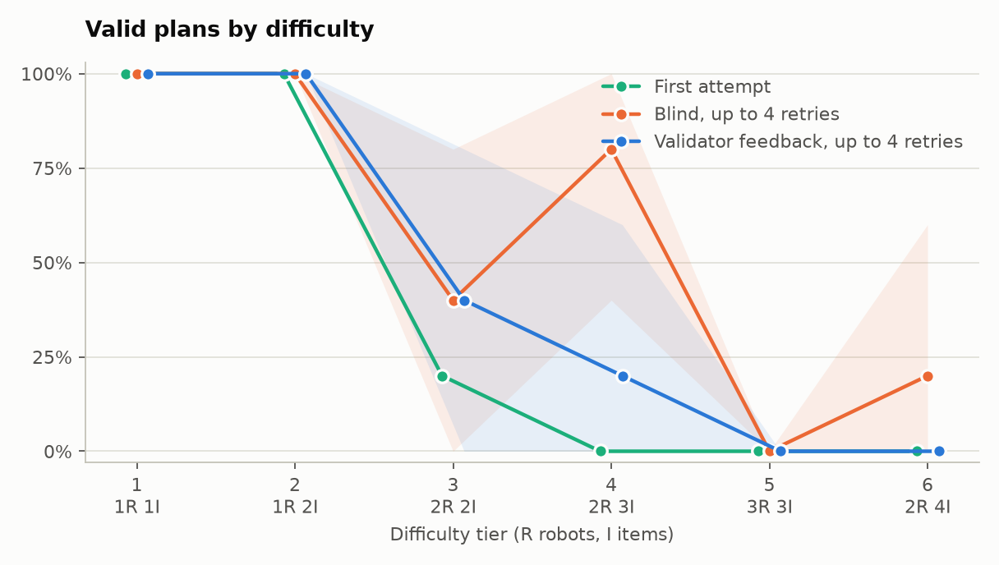
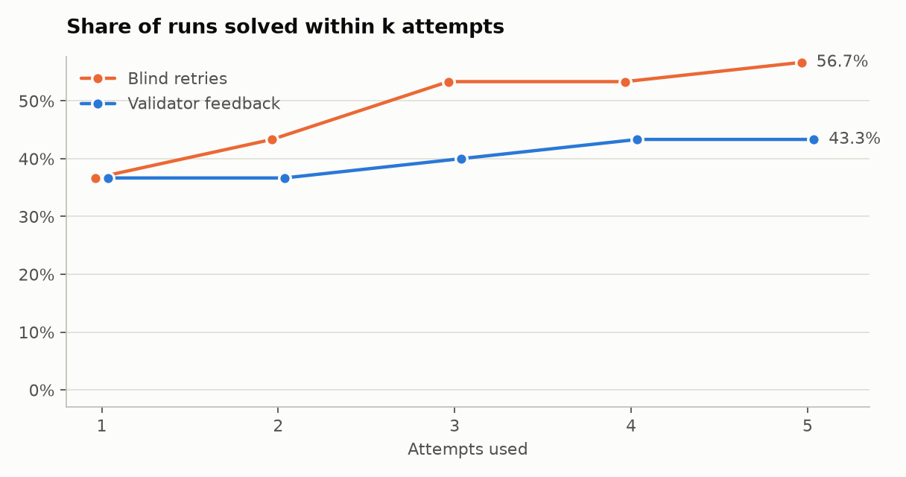
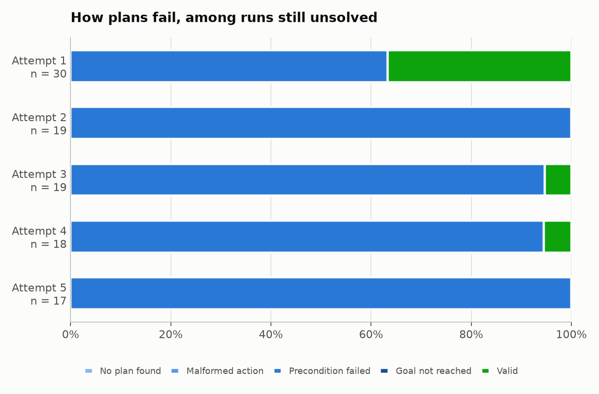
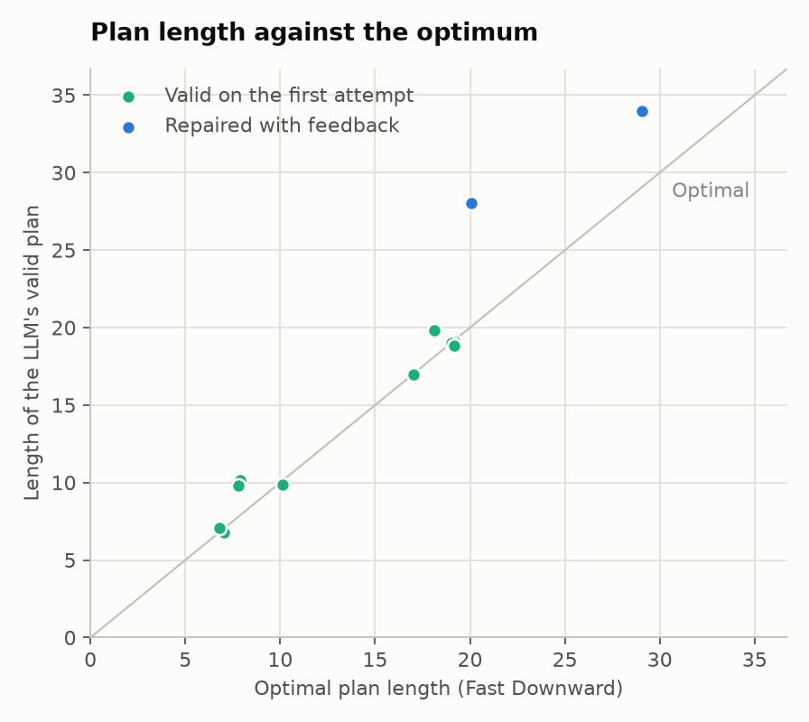

# Results: Qwen/Qwen2.5-1.5B-Instruct+lora

Generated by `python -m warehouse_planning.report`. Do not edit by hand.

30 problems, 1 replicates each, temperature 0.3, up to 4 retries. Intervals are 95% bootstraps over problems.

| Metric | Validator feedback | Blind retries |
|---|---:|---:|
| Runs | 30 | 30 |
| Valid on the first attempt | 36.7% | 36.7% |
| 95% interval | 20.0 to 53.3% | 20.0 to 53.3% |
| **Valid after up to 4 retries** | **43.3%** | **56.7%** |
| 95% interval | 26.7 to 60.0% | 40.0 to 73.3% |
| Items delivered, share of all items | 58.9% | 71.9% |
| Failed first attempts later fixed | 10.5% | 31.6% |
| Mean retries, all solved runs | 0.38 | 0.71 |
| Mean retries, runs that needed one | 2.50 | 2.00 |
| Plan length / optimal, mean | 1.09 | 1.07 |
| Plan length / optimal, median | 1.00 | 1.00 |
| Valid plans that are optimal | 61.5% | 52.9% |

Feedback minus blind retries: -13.3 points (95% interval -26.7 to -3.3).

## By difficulty

| Tier | Robots, items | Mean optimal length | First attempt | Blind retries | Validator feedback | Items delivered, blind | Items delivered, feedback |
|---|---|---:|---:|---:|---:|---:|---:|
| 1 | 1, 1 | 8.0 | 100.0% | 100.0% | 100.0% | 100.0% | 100.0% |
| 2 | 1, 2 | 18.2 | 100.0% | 100.0% | 100.0% | 100.0% | 100.0% |
| 3 | 2, 2 | 18.2 | 20.0% | 40.0% | 40.0% | 50.0% | 50.0% |
| 4 | 2, 3 | 29.0 | 0.0% | 80.0% | 20.0% | 80.0% | 40.0% |
| 5 | 3, 3 | 29.2 | 0.0% | 0.0% | 0.0% | 26.7% | 13.3% |
| 6 | 2, 4 | 38.2 | 0.0% | 20.0% | 0.0% | 75.0% | 50.0% |

## By attempt

| Attempt | Runs | No plan found | Malformed action | Precondition failed | Goal not reached | Valid |
|---|---:|---:|---:|---:|---:|---:|
| 1 | 30 | 0.0% | 0.0% | 63.3% | 0.0% | 36.7% |
| 2 | 19 | 0.0% | 0.0% | 100.0% | 0.0% | 0.0% |
| 3 | 19 | 0.0% | 0.0% | 94.7% | 0.0% | 5.3% |
| 4 | 18 | 0.0% | 0.0% | 94.4% | 0.0% | 5.6% |
| 5 | 17 | 0.0% | 0.0% | 100.0% | 0.0% | 0.0% |

## Plan quality

