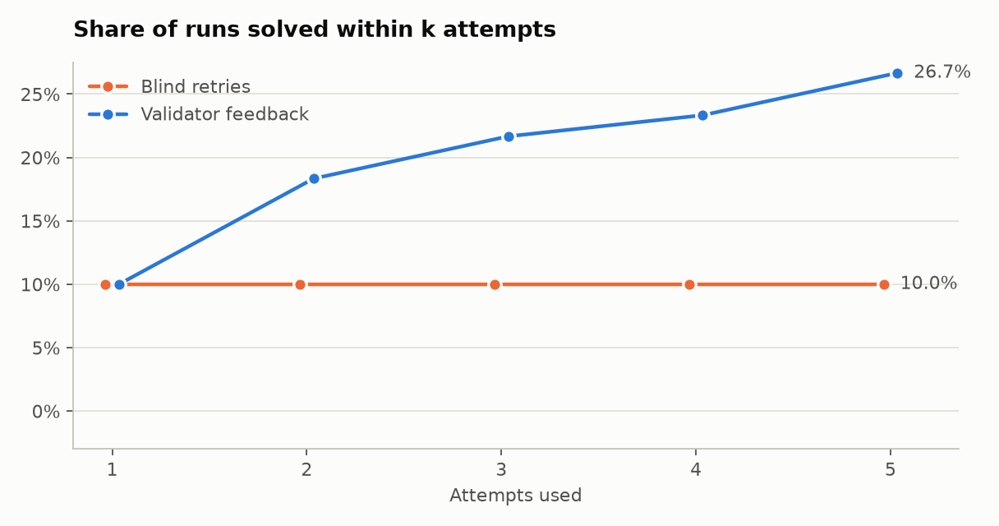
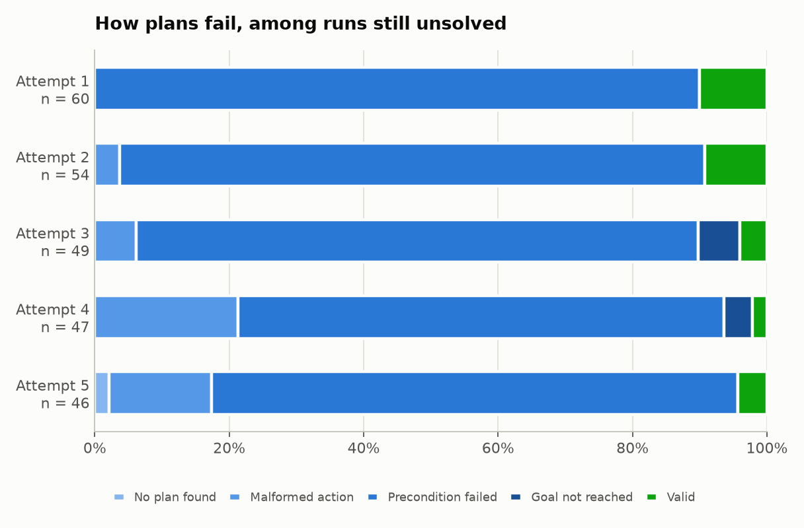
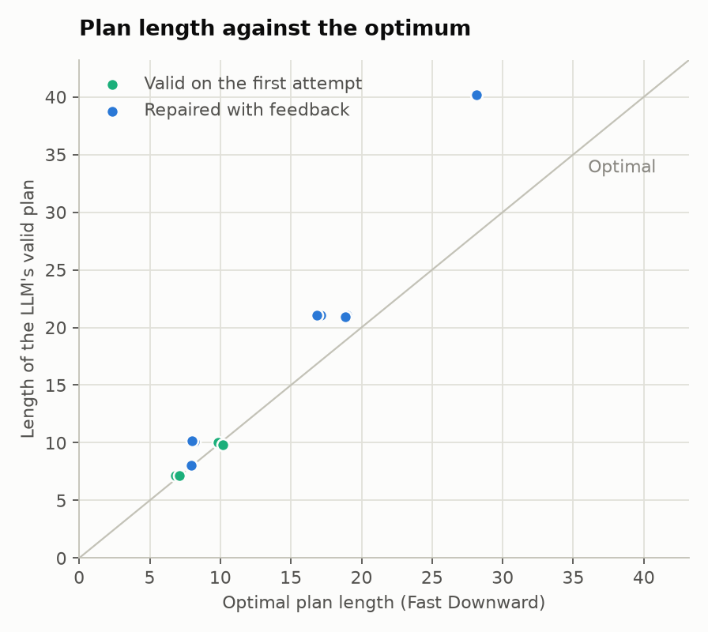
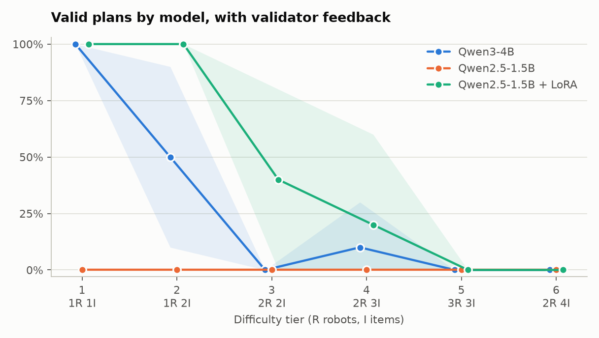

# Results: Qwen/Qwen3-4B-Instruct-2507

Generated by `python -m warehouse_planning.report`. Do not edit by hand.

30 problems, 2 replicates each, temperature 0.3, up to 4 retries. Intervals are 95% bootstraps over problems.

| Metric | Validator feedback | Blind retries |
|---|---:|---:|
| Runs | 60 | 60 |
| Valid on the first attempt | 10.0% | 10.0% |
| 95% interval | 0.0 to 23.3% | 0.0 to 23.3% |
| **Valid after up to 4 retries** | **26.7%** | **10.0%** |
| 95% interval | 11.7 to 41.7% | 0.0 to 23.3% |
| Items delivered, share of all items | 49.6% | 32.8% |
| Failed first attempts later fixed | 18.5% | 0.0% |
| Mean retries, all solved runs | 1.25 | 0.00 |
| Mean retries, runs that needed one | 2.00 | n/a |
| Plan length / optimal, mean | 1.11 | 1.00 |
| Plan length / optimal, median | 1.05 | 1.00 |
| Valid plans that are optimal | 50.0% | 100.0% |

Feedback minus blind retries: +16.7 points (95% interval +5.0 to +30.0).

## By difficulty

| Tier | Robots, items | Mean optimal length | First attempt | Blind retries | Validator feedback | Items delivered, blind | Items delivered, feedback |
|---|---|---:|---:|---:|---:|---:|---:|
| 1 | 1, 1 | 8.0 | 60.0% | 60.0% | 100.0% | 60.0% | 100.0% |
| 2 | 1, 2 | 18.2 | 0.0% | 0.0% | 50.0% | 45.0% | 90.0% |
| 3 | 2, 2 | 18.2 | 0.0% | 0.0% | 0.0% | 35.0% | 40.0% |
| 4 | 2, 3 | 29.0 | 0.0% | 0.0% | 10.0% | 23.3% | 26.7% |
| 5 | 3, 3 | 29.2 | 0.0% | 0.0% | 0.0% | 13.3% | 13.3% |
| 6 | 2, 4 | 38.2 | 0.0% | 0.0% | 0.0% | 20.0% | 27.5% |

## By attempt

| Attempt | Runs | No plan found | Malformed action | Precondition failed | Goal not reached | Valid |
|---|---:|---:|---:|---:|---:|---:|
| 1 | 60 | 0.0% | 0.0% | 90.0% | 0.0% | 10.0% |
| 2 | 54 | 0.0% | 3.7% | 87.0% | 0.0% | 9.3% |
| 3 | 49 | 0.0% | 6.1% | 83.7% | 6.1% | 4.1% |
| 4 | 47 | 0.0% | 21.3% | 72.3% | 4.3% | 2.1% |
| 5 | 46 | 2.2% | 15.2% | 78.3% | 0.0% | 4.3% |

## Plan quality

## By model

| Model | Runs | First attempt | After retries, feedback | After retries, blind | Items delivered, feedback | Length / optimal |
|---|---:|---:|---:|---:|---:|---:|
| Qwen3-4B | 60 | 10.0% | 26.7% | 10.0% | 49.6% | 1.11 |
| Qwen2.5-1.5B | 30 | 0.0% | 0.0% | 3.3% | 0.0% | n/a |
| Qwen2.5-1.5B + LoRA | 30 | 36.7% | 43.3% | 56.7% | 58.9% | 1.09 |
